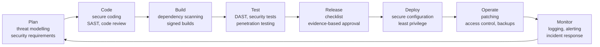

# DevSecOps and the SDLC

A plain-English guide to what changes when security stops being a
last-minute check and becomes part of how software is built, shipped,
and run.

If you are new to this: start at the top and read down. Every idea is
explained before it is used, and there is a glossary at the end.

---

## Contents

- [The short version](#the-short-version)
- [1. What is the SDLC?](#1-what-is-the-sdlc)
- [2. What is DevOps?](#2-what-is-devops)
- [3. What is DevSecOps?](#3-what-is-devsecops)
- [4. What changes at each stage of the SDLC](#4-what-changes-at-each-stage-of-the-sdlc)
- [5. Shift-left, explained properly](#5-shift-left-explained-properly)
- [6. Automation: what gets automated, and what should not be](#6-automation-what-gets-automated-and-what-should-not-be)
- [7. The main challenges of doing DevSecOps](#7-the-main-challenges-of-doing-devsecops)
- [8. Real examples](#8-real-examples)
- [9. How to start small](#9-how-to-start-small)
- [10. My write-up on this topic](#10-my-write-up-on-this-topic)
- [11. What came out of the group discussion](#11-what-came-out-of-the-group-discussion)
- [12. Common mistakes](#12-common-mistakes)
- [Glossary](#glossary)
- [Further reading](#further-reading)

---

## The short version

Software used to be built in a straight line: plan it, write it, test
it, then hand it to a security team at the end and hope nothing bad
turns up. That last step was slow, it found problems too late to fix
cheaply, and it often got skipped when a deadline was close.

DevOps changed the first part of that story: developers and operations
people stopped working in separate silos and started shipping small
changes often, using automation to build, test, and deploy.

DevSecOps is the same idea, with security added as a third equal
partner. Instead of security being a gate at the end, security checks
run all the way through — while you plan, while you write code, while
you build and test, and while the software is running in production.
The goal is simple: find problems early, when they are cheap and easy
to fix, and make the safe way the easy way, so people do not have to
work around it to get their job done.

> **One sentence to remember:** DevSecOps does not add a security
> phase to the SDLC. It spreads security across every phase that is
> already there.

---

## 1. What is the SDLC?

SDLC stands for **Software Development Life Cycle**. It is just a name
for the stages a piece of software goes through, from the first idea to
the day it is switched off.

There are different versions of it (Waterfall, Agile, and others), but
the stages are basically the same:

| Stage | Plain-English question |
| --- | --- |
| **Plan** | What are we building, and for whom? |
| **Code** | Write the software. |
| **Build** | Turn the code into something that can run. |
| **Test** | Does it work? Does it break? |
| **Release** | Package it up and get it ready to ship. |
| **Deploy** | Put it live where users can reach it. |
| **Operate** | Keep it running day to day. |
| **Monitor** | Watch it, learn from it, and fix what goes wrong. |

Then the cycle repeats: what you learn from monitoring feeds back
into planning the next change.

### Why the SDLC matters for security

Every stage is a chance to either build a problem in or catch one.
A bad decision in planning (for example, "we will store passwords as
plain text, we can fix it later") is far more expensive to fix after
release than it is to avoid in planning. A bug written in the code
stage is cheapest to fix in the code stage, and most expensive to fix
after users are already affected.

That is the whole logic of DevSecOps: **put the security work where
the problem is created, not where it is discovered.**

---

## 2. What is DevOps?

DevOps is a way of working, not a product you can buy.

- **Dev** = the people who write the software.
- **Ops** = the people who run it in production (servers, networks,
  databases, uptime).

Traditionally those two groups worked separately and blamed each other
when things went wrong: developers threw code over the wall, operations
complained it was hard to run. DevOps brings them together around one
shared goal — shipping small, safe changes quickly and reliably —
using three things:

1. **Automation.** Computers do the repetitive work: building the
   code, running tests, deploying. Humans do the thinking.
2. **Small, frequent releases.** Instead of one huge release every six
   months, many small releases. A small change is easier to test, easier
   to understand, and easier to roll back if it breaks.
3. **Feedback loops.** Monitoring, logs, and user feedback flow back
   to the team fast, so the next change is based on what actually
   happened, not on guesses.

A key tool here is the **CI/CD pipeline** — a chain of automated steps
that runs every time code is changed: it builds the code, runs tests,
and, if everything passes, deploys it. Think of it like a factory
conveyor belt with quality checks at every station. DevSecOps adds
security checks to that same belt.

---

## 3. What is DevSecOps?

DevSecOps adds **Sec** (security) to DevOps, as an equal partner
rather than an afterthought.

### The old way (security at the end)

```
Plan -> Code -> Build -> Test -> Release -> Deploy -> [Security check] -> Operate
```

Problems with this:

- The security team sees the software for the first time when it is
  basically finished.
- Fixing a design flaw at this point can mean rewriting large parts
  of the software, so it gets delayed — or shipped anyway, with a
  known hole in it.
- Security becomes the team that says "no" and slows releases down,
  so developers start to see it as the enemy.

### The DevSecOps way (security all the way through)

```
Plan (+ security) -> Code (+ security) -> Build (+ security)
  -> Test (+ security) -> Release (+ security) -> Deploy (+ security)
  -> Operate (+ security) -> Monitor (+ security) -> back to Plan
```

The same SDLC, but every stage has a security job attached to it.
Section 4 walks through each one.

### What DevSecOps is NOT

- It is not "the security team now does everything." It is the
  opposite: security becomes **everyone's** job, with the security
  team acting as coaches and tool-builders rather than gatekeepers.
- It is not "buy a scanner and you are done." A scanner is one tool.
  DevSecOps is also about how people work, what they check, and what
  happens when a check fails.
- It is not "slow everything down for safety." Done well, it should
  make releases *safer and faster*, because problems are caught by a
  machine in minutes instead of by a person in a review meeting two
  weeks later.

---

## 4. What changes at each stage of the SDLC

This is the core of the whole topic. For each stage: what it is, what
security looks like there, and what goes wrong if you skip it.

### Plan — decide what "secure" means before you build

**What happens here:** The team works out what to build, who will use
it, and what could go wrong.

**Security in this stage:**

- **Threat modelling.** Sit down and ask: who might attack this, how,
  and what would they get? You do not need a formal framework to start.
  A whiteboard, the main things the system stores, and the question
  "what is the worst thing that could happen here?" will get you a long
  way. Do it early, because changing an architecture on paper costs
  nothing and changing it in code costs weeks.
- **Security requirements.** Write down the non-negotiables alongside
  the features: "passwords must be hashed, never stored in plain text",
  "only logged-in users can see their own data", "personal data must be
  encrypted". If it is not written down, it will be forgotten under
  deadline pressure.
- **Compliance and privacy.** If the software handles personal data,
  health data, or payment data, there are rules about how it must be
  handled. Find out early — retrofitting privacy into a finished system
  is painful.

**If you skip it:** You build the wrong thing securely, or the right
thing insecurely, and discover it only after launch.

### Code — write secure code, and check it as you write

**What happens here:** Developers write the software.

**Security in this stage:**

- **Secure coding.** The everyday habits that prevent the most common
  bugs: never trust input from a user (validate it), never build
  database queries by pasting user input into them (use parameterised
  queries), never store secrets such as passwords or API keys in the
  code itself, and use well-tested libraries instead of writing your
  own encryption.
- **Static analysis (SAST).** A tool reads your code without running it
  and flags patterns that look risky — for example, a hardcoded password
  or a known unsafe function. It runs automatically when code is saved
  or submitted, so feedback arrives in minutes.
- **Code review with security in mind.** A second person reads the
  change before it is merged. They are not just checking "does it
  work?" but also "could someone misuse this?"
- **Secrets management.** Passwords, API keys, and tokens live in a
  secrets manager or environment variables — never in the source code
  repository, where anyone with access can read them.

**If you skip it:** Vulnerabilities get written in at the same speed
as features, and every one of them has to be found and fixed later.

### Build — make sure what you built is what you think it is

**What happens here:** The code is compiled or packaged, and its
dependencies (the libraries it relies on) are pulled in.

**Security in this stage:**

- **Dependency scanning (SCA).** Most software is built on top of
  other people's libraries. A scanner checks whether any of those
  libraries has a known vulnerability, so you can update it before
  shipping. This matters a lot: many real breaches come through an
  old library, not through code the team wrote.
- **Signed builds.** The build is signed, so later stages can check
  that nobody tampered with it on the way to production. If the
  signature does not match, the build is not deployed.

**If you skip it:** You ship software containing a library with a
published vulnerability, even though a fix already existed.

### Test — try to break it before an attacker does

**What happens here:** The software is tested to see if it works.

**Security in this stage:**

- **Dynamic analysis (DAST).** A tool probes the *running* application
  from the outside, like an attacker would — trying odd inputs,
  looking for error messages that leak information, checking login
  behaviour. It catches things static analysis cannot see.
- **Security test cases.** Tests that check the security requirements
  from the plan stage: can a user see another user's data by changing
  a number in the URL? What happens with a very long input? What
  happens after five wrong passwords?
- **Penetration testing.** A person (or team) deliberately tries to
  break into the system, using the same techniques real attackers use.
  This is usually done less often — before a big release, for example —
  because it takes time and skill.

**If you skip it:** The first person to test your security is a real
attacker, in production, with real users' data at stake.

### Release — a final check before it goes out

**What happens here:** The tested build is packaged and approved for
deployment.

**Security in this stage:**

- **Release checklist.** A short, written list: all security scans
  passed, no high-severity issues open, secrets rotated if needed,
  rollback plan ready. Boring, and exactly why it works.
- **Approval that is based on evidence, not on memory.** The pipeline
  shows which checks ran and passed; a human is not asked to just
  "trust that it is fine."

**If you skip it:** A build with a failed security scan ships because
nobody noticed the scan failed.

### Deploy — put it live, safely

**What happens here:** The software is installed on the servers users
reach.

**Security in this stage:**

- **Secure configuration.** Servers, containers, and cloud settings are
  set up from checked, version-controlled templates (infrastructure as
  code), not by hand on a Friday afternoon. Misconfiguration — a storage
  bucket left public, a database port left open to the internet — is one
  of the most common causes of breaches.
- **Least privilege.** The deployment process, and the software itself,
  get only the permissions they actually need. If the software is
  compromised, the damage is limited to what it could reach.
- **Rollback plan.** If the new version has a problem, you can go back
  to the previous version quickly. This is a security control as well as
  a reliability one: it means a bad release does not have to stay live
  while someone figures out a fix.

**If you skip it:** A perfectly good application is deployed on a
server that anyone on the internet can log into.

### Operate — keep it running, and keep it patched

**What happens here:** The software is live and in everyday use.

**Security in this stage:**

- **Patching.** When a vulnerability is found in the software or one of
  its libraries, it gets fixed and deployed promptly — not added to a
  list that is reviewed next quarter.
- **Access control.** Who can log in, who can change settings, who can
  see what. People who leave the team lose access. Admin accounts are
  used only when needed.
- **Backups.** Regular, tested backups. A backup you have never tried
  to restore from is not a backup, it is a hope.

**If you skip it:** A system that was secure on launch day slowly
becomes insecure as new vulnerabilities are published and nobody
applies the fixes.

### Monitor — watch, learn, respond

**What happens here:** Logs, alerts, and metrics are watched, and
incidents are handled.

**Security in this stage:**

- **Logging and monitoring.** Login attempts, errors, unusual traffic —
  recorded in a way that can actually be searched later. When something
  goes wrong, the first question is always "what happened, and when?"
  and logs are the only way to answer it.
- **Alerting that people actually read.** Too many alerts is as bad as
  too few: people stop reading them. Alerts should be tuned so that
  when one fires, it means something.
- **Incident response.** A written plan for the bad day: who decides,
  who talks to users, how you stop the bleeding, and how you learn from
  it afterwards. Practising it before you need it makes the real thing
  much less chaotic.

**If you skip it:** An attacker can be inside a system for weeks or
months, and nobody notices until the damage is done.

### The whole picture



The arrow back from Monitor to Plan is the point: security is a loop,
not a line. What you learn from running the software changes what you
plan next.

---

## 5. Shift-left, explained properly

"Shift-left" is the phrase you will hear most in DevSecOps, and it is
often explained badly.

Imagine the SDLC as a timeline running left to right: plan on the left,
operate on the right. "Shifting left" means moving a task earlier on
that timeline — doing it in planning or coding instead of in testing
or after release.

**Why it helps:**

- **It is cheaper.** Finding a design flaw in a planning meeting costs
  an hour of discussion. Finding it after release can cost a rewrite,
  a hotfix, downtime, and an apology to users.
- **It is faster.** An automated scan that runs in two minutes while
  code is being written gives feedback before the developer has moved
  on to the next task. A manual security review two weeks later means
  the developer has to stop, remember what they wrote, and fix it.
- **It changes who fixes it.** The person who wrote the code fixes it,
  while they still remember it, instead of a separate team filing a
  ticket that sits in a queue.

**What shift-left is not:**

- It is not "do all security in planning and then forget about it."
  Some things can only be checked on a running system.
- It is not "make developers do the security team's job with no help."
  The security team still exists — they build the tools, write the
  guidance, and handle the hard cases. Developers get guardrails and
  fast feedback, not a second full-time job.

---

## 6. Automation: what gets automated, and what should not be

Automation is what makes DevSecOps possible at the speed DevOps works
at. Without it, security checks would be a manual bottleneck on every
release. But not everything should be automated.

### Automate these

| Check | Why it works automated |
| --- | --- |
| Static code scanning (SAST) | Same rules, every time, in minutes |
| Dependency scanning (SCA) | Checks thousands of libraries against known vulnerabilities — no human could do this by hand |
| Secrets scanning | Catches a leaked key the moment it is committed |
| Configuration checks | Verifies servers and cloud settings match a known-good template |
| Running security tests | Same tests, every release, no forgetting |

### Keep a human in the loop for these

| Task | Why a human is needed |
| --- | --- |
| Threat modelling | Needs judgement about what matters and what is realistic |
| Reviewing a new kind of risk | No scanner knows your business logic |
| Deciding whether to ship with a known issue | A risk decision: how bad is it, who is affected, what is the workaround? |
| Incident response | Judgement, communication, and decisions under pressure |
| Tuning alerts | Deciding what is worth waking someone up for |

**The rule of thumb:** automate the repetitive checking, keep humans
for the judgement calls. If a check fails, the pipeline should stop
and say *what* failed and *where* — not just "error" — so the fix is
obvious.

---

## 7. The main challenges of doing DevSecOps

This is where most teams struggle. The tools are the easy part. The
hard part is people, habits, and trade-offs.

### 1. Culture and buy-in

Security used to be someone else's job. DevSecOps asks developers to
care about security and security people to care about delivery speed.
That is a real change in how people work, and it meets resistance:
"this is not my job", "this slows me down", "we have always done it
this way."

What helps: make the secure way the easy way. If the safe path takes
ten extra steps and the unsafe path takes one, people will take the
unsafe path. Give teams tools that check automatically, templates that
are secure by default, and quick answers when they are stuck.

### 2. Speed vs. security

DevOps is about shipping fast. Security checks take time. If a scan
adds an hour to every release, teams will find a way around it.

What helps: keep checks fast and run them in parallel where possible.
Block a release only for genuinely serious findings, and fix the small
stuff on a schedule instead. Measure how long the pipeline takes, and
treat "the security step is slow" as a problem to fix, not as a fact
of life.

### 3. Tool overload and false positives

There are a lot of security tools, and they all produce alerts. A tool
that cries wolf — flagging hundreds of issues, most of them harmless —
teaches people to ignore all of its alerts, including the real ones.
This is called alert fatigue, and it is one of the most common reasons
DevSecOps fails in practice.

What helps: tune the tools. Turn off rules that do not apply to your
project, prioritise by actual risk, and fix the noisy rules instead of
telling people to "just check them all."

### 4. Skills gap

Developers are not usually trained in security, and security people
are not usually trained in how software is built. Each side needs to
learn some of the other's world.

What helps: short, practical training tied to real code the team
actually writes — not generic lectures. Pairing a developer with a
security person on a real task teaches more than a slide deck.

### 5. Legacy systems

Old systems were not built for this. They may have no automated tests,
no pipeline, hardcoded secrets, and nobody left who fully understands
them. You cannot rebuild them overnight, and you cannot leave them
unprotected either.

What helps: start with the highest-risk legacy system, add the cheapest
protections first (monitoring, access control, patching), and improve
it gradually. "Start small" beats "wait until we can do everything."

### 6. Who is responsible?

When everyone is responsible for security, it is easy for nobody to
actually be responsible. A vulnerability can sit unfixed because each
team assumes another team owns it.

What helps: write it down. For each system, name who owns security
decisions, who fixes what, and by when. Shared responsibility still
needs a named owner.

---

## 8. Real examples

### Example 1: The hardcoded password

A developer puts a database password directly in the code so the
application can connect while testing. It works, so it ships. Months
later, the code repository is shared with a contractor, or made public
by mistake, and the password is in there for anyone to read.

DevSecOps answer: a secrets scanner runs on every code submission and
blocks the change if it finds something that looks like a password or
API key. The password lives in a secrets manager instead, and the code
reads it from there.

### Example 2: The old library

A web application uses a popular library for handling file uploads.
A vulnerability is found in that library and a fixed version is
released. The team never notices, because nobody checks.

DevSecOps answer: dependency scanning runs on every build and flags the
vulnerable library with the fixed version number. The team updates it
as part of a normal release, before anyone exploits it.

### Example 3: The scan that blocks every deploy

A security scan is added to the pipeline and flags dozens of issues on
every release, most of them low-risk. Developers cannot ship, so they
start skipping the pipeline and deploying by hand — which defeats the
whole point.

DevSecOps answer: tune the scan so it blocks only high-severity
findings, put the rest on a fix list with deadlines, and review the
rules regularly. The pipeline becomes a helper again instead of a wall.

### Example 4: The public storage bucket

A team stores user uploads in cloud storage. Someone changes a setting
during testing and forgets to change it back, leaving the storage
publicly readable on the internet.

DevSecOps answer: infrastructure is defined as code and checked
automatically before deployment, and a monitoring tool alerts if a
storage bucket ever becomes public. The misconfiguration is caught in
minutes, not months.

### Example 5: The breach nobody noticed

An attacker gets in through a stolen password and quietly copies data
for weeks. There are no useful logs, and nobody is watching the alerts
that do exist.

DevSecOps answer: logging and monitoring are part of the build from
the start, alerts are tuned so that real anomalies stand out, and
there is a written incident response plan so the team knows what to do
in the first hour.

---

## 9. How to start small

If you are learning this, or a team is starting from zero, do not try
to do everything at once. This order works well:

1. **Write down your security requirements.** A short list for your
   project: how passwords are stored, who can see what, what data is
   encrypted.
2. **Add one automated check to the pipeline.** Dependency scanning is
   a good first one — it is easy to set up and catches real problems.
3. **Add secrets scanning.** It prevents the most embarrassing kind of
   leak.
4. **Do one threat modelling session.** One hour, one feature, one
   whiteboard. Write down what you found.
5. **Set up basic monitoring and alerting.** Logins, errors, and
   unusual traffic — and make sure someone actually reads the alerts.
6. **Review and tune.** After a month, look at what the tools flagged.
   Turn off the noisy rules. Fix the real issues. Then add the next
   check.

Small, working, and actually used beats big, perfect, and ignored.

---

## 10. My write-up on this topic

> **Note on sources:** the original write-up is not reproduced word
> for word here, because the exact text was not kept in a file. What
> follows is a faithful summary of its argument, based on the notes
> kept at the time. No sentences below are presented as direct quotes
> from the original.

**The question it answered:** how does integrating security into
DevOps (DevSecOps) change the software development lifecycle, and
what are the main challenges in implementing it?

**The argument, in summary:**

- DevSecOps moves security earlier in the lifecycle and bakes it into
  design, code scanning, and post-deployment monitoring, instead of
  leaving it as a final check before release.
- Security becomes part of every stage, not a separate stage: threat
  modelling and security requirements in planning, scanning and secure
  coding while code is written, checks in the build and test stages,
  and logging and monitoring once the software is running.
- The challenges it named were: getting team buy-in when security
  feels like it slows releases down; the gap in secure-coding skills
  among developers; tool alert overload and false positives, which
  make people stop paying attention; and legacy systems that were not
  built for automated pipelines or modern security checks.
- Its practical advice was to start small rather than trying to
  automate everything at once: pick one or two checks, get them
  working, and build from there.

That is the same argument this README makes in full — the README is
the expanded, beginner-friendly version of it, with the stages,
examples, and glossary spelled out.

---

## 11. What came out of the group discussion

After the write-up above, six people joined the same discussion and
each posted their own take on DevSecOps and the SDLC. I read all six
and replied to each one individually, with a reply that responded to
that person's actual points rather than a generic "great post".

The six people were: Hardik Behal, Nana Sackey, Mohammed Fazal
Shaikh, Mihirkumar Manojkumar Prajapati, Kanushtika Mahendran, and
Faisal Mahmood.

> **Honest note on this section:** the detailed contents of each
> person's post were not kept in my notes — only that they posted, and
> that I replied to each of them. So I am not going to invent a
> summary of what each individual said. What follows is only what the
> notes actually support, plus the general themes that came up across
> the discussion as a whole.

**What is supported by the notes:**

- All six posts were on the same topic: how DevSecOps changes the
  SDLC and the challenges of implementing it.
- Each reply was tailored to the person it was answering, not copied
  and pasted. The point of replying to all six, rather than just one,
  was to engage with the different angles people had taken instead of
  repeating the same comment six times.
- The discussion as a whole kept coming back to the same tensions
  described in Section 7: security vs. release speed, too many tool
  alerts, skills, and old systems that do not fit the new way of
  working. Different people weighted those tensions differently,
  which is why the replies had to be different too.

**What I took away from it:**

- There is no single "right" order to adopt DevSecOps. People agreed
  on the direction — earlier, more automated, more shared — and
  disagreed on what to do first, which is exactly the kind of thing
  that depends on the team and the system.
- A discussion like this is useful for the same reason code review is
  useful: someone else will notice the angle you missed. Reading six
  different takes on the same question gave a fuller picture than any
  one write-up on its own.

---

## 12. Common mistakes

| Mistake | What happens | Do this instead |
| --- | --- | --- |
| Treating DevSecOps as a tool purchase | A scanner is installed, nothing else changes, and the same insecure habits continue | Change the process too: checks in the pipeline, named owners, fix deadlines |
| Blocking every release on every finding | Teams route around the pipeline | Block only on serious findings; schedule the rest |
| Ignoring false positives | People stop reading alerts entirely | Tune the tools; fix noisy rules |
| Security as a separate team that says "no" | Developers see security as the enemy | Security team as coaches: build guardrails, give fast feedback |
| Trying to do everything at once | Nothing gets finished, and the team gives up | Start small — one check, then the next |
| Forgetting the "operate and monitor" stages | Software is secure on launch day and slowly rots | Patching, access reviews, backups, and tuned alerting as ongoing work |
| No named owner | "Everyone is responsible" becomes "nobody fixes it" | Name an owner for each system and each open issue |

---

## Glossary

| Term | Meaning |
| --- | --- |
| **SDLC** | Software Development Life Cycle — the stages software goes through, from planning to monitoring. |
| **DevOps** | A way of working where developers and operations work together, shipping small changes often with automation. |
| **DevSecOps** | DevOps with security built into every stage, instead of checked only at the end. |
| **CI/CD pipeline** | An automated chain of steps that builds, tests, and deploys code every time it changes. CI = Continuous Integration, CD = Continuous Delivery/Deployment. |
| **Shift-left** | Moving a task earlier in the SDLC, so problems are found when they are cheap to fix. |
| **SAST** | Static Application Security Testing — a tool that reads code without running it and flags risky patterns. |
| **DAST** | Dynamic Application Security Testing — a tool that probes a running application from the outside, like an attacker would. |
| **SCA** | Software Composition Analysis — checking the libraries your software depends on for known vulnerabilities. |
| **Threat modelling** | Working out, before or during building, who might attack a system, how, and what they would get. |
| **Secrets** | Passwords, API keys, and tokens. They must never be stored in source code. |
| **Secrets manager** | A tool that stores secrets securely and gives them to software that needs them, without putting them in code. |
| **Infrastructure as code** | Defining servers, networks, and cloud settings in version-controlled files instead of setting them up by hand. |
| **Least privilege** | Giving a person or a program only the permissions it actually needs, and no more. |
| **False positive** | A security tool flagging something as a problem when it is actually harmless. Too many of these cause alert fatigue. |
| **Alert fatigue** | When so many alerts fire — mostly harmless — that people stop reading them, including the real ones. |
| **Penetration testing** | Deliberately trying to break into a system, using attacker techniques, to find weaknesses before a real attacker does. |
| **Incident response** | The plan for what to do when something goes wrong: who decides, what gets shut down, who is told, and how you learn from it. |
| **Rollback** | Going back to the previous working version of software after a bad release. |
| **CIA triad** | Confidentiality, Integrity, Availability — the three properties a secure system must protect. See the companion write-up on the CIA triad in DevSecOps. |

---

## Further reading

These are good next steps if you want to go deeper. They are public,
well-known sources — no single one of them is the "answer", and they
are worth reading in this order:

- **OWASP Top 10** — the ten most common web application security
  risks, explained simply, with examples. A good checklist for the
  code and test stages.
- **NIST SP 800-218, Secure Software Development Framework (SSDF)** —
  a practical framework for building security into software
  development, organised by what to do at each stage.
- **NIST SP 800-53** — a catalogue of security controls. More of a
  reference than a book to read cover to cover.
- **The Phoenix Project, by Gene Kim, Kevin Behr, and George Spafford**
  — a novel about DevOps, bottlenecks, and why shipping fast and
  shipping safely are the same problem. The most readable introduction
  to the culture side of this topic.

---

*Written as a personal learning project. The write-up in Section 10 is
summarised from notes, not quoted verbatim — see the note at the start
of that section.*
